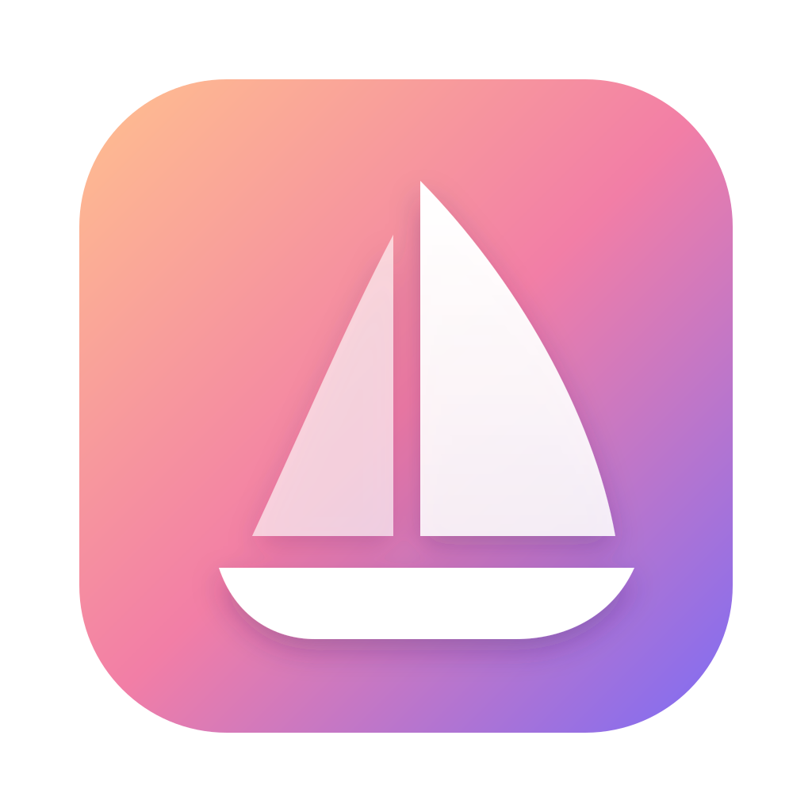
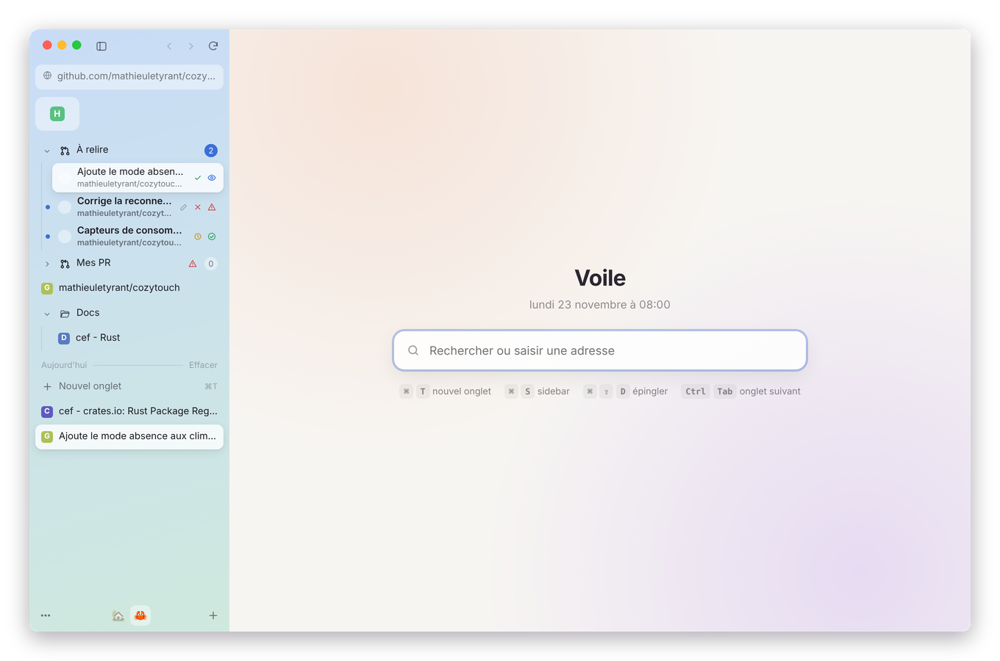

<div align="center">



# Voile

**An Arc-style browser, written in Rust on Chromium.**
Spaces, pinned tabs that remember where they belong, a command bar, Chrome extensions, and folders that fill themselves with your GitHub pull requests.

[](https://github.com/mathieuletyrant/voile-browser/releases/latest)




</div>

## ✨ Features

**Like Arc**

- 🗂️ **Spaces**: one sidebar per context (Personal, Dev…), each with its own colours and icon
- 📌 **Pinned tabs**: they stay, unload with ⌘W, and come back to their original URL in one click
- ⭐ **Favorites**: the tiles at the top, shared by every space
- 📁 **Folders**: drag tabs in and out, double-click to rename
- 🌅 **Today**: unpinned tabs are archived after 12 hours, *Clear* empties them now
- ⌨️ **Command bar** (⌘T / ⌘L): open a URL, search the web, jump to an open tab, a pull request or a recently closed tab, run an action
- ↔️ **Hide the sidebar** (⌘S), resize it from its edge

**Chromium inside**

- 🧩 **Chrome extensions**: install from the Chrome Web Store, icons in the Chrome toolbar
- 🔑 **Chrome profile**: passwords, history, downloads, `chrome://settings`
- 🪟 **Real popups** for sign-in flows (OAuth), everything else opens as a Voile tab

**GitHub Live Folders**

- 🐙 **Folders fed by a GitHub search**: *to review*, *my PRs*, *mentions*, *assigned*, or any query (`is:pr is:open repo:owner/name`)
- 🔵 **Unread dot** for what changed since you last looked, refreshed every minute
- 🚦 **Status at a glance**: checks passing, failing or pending, approved, changes requested, review required, draft, conflicts
- 🔗 One click opens the PR, a second click comes back to the same tab

## 🚀 Install

1. Download `Voile-x.y.z-arm64.dmg` from the [latest release](https://github.com/mathieuletyrant/voile-browser/releases/latest) (Apple Silicon, macOS 12+).
2. Open it and drag **Voile** into **Applications**.
3. First launch: **right-click Voile → Open**, then **Open** again.

> [!NOTE]
> Releases are ad-hoc signed until a Developer ID is configured (see [Signing](#-signing)), so macOS asks for confirmation once.
> If it says the app is damaged instead: `xattr -dr com.apple.quarantine /Applications/Voile.app`

### 🐙 GitHub token

Live Folders read the first token they find:

| Source | |
|---|---|
| `VOILE_GITHUB_TOKEN` | |
| `GITHUB_TOKEN`, `GH_TOKEN` | |
| `gh auth token` | the simplest: run `gh auth login` once |

The token needs `repo` (private repositories) and `read:org`. Apps launched from the Dock don't see your shell variables, so `gh auth login` is the way to go there (Voile finds `gh` in Homebrew's folders).

## ⌨️ Shortcuts

| | |
|---|---|
| ⌘T | Command bar, new tab |
| ⌘L | Command bar on the current tab |
| ⌘W | Close the tab (a pinned tab is only unloaded) |
| ⌘⇧T | Reopen the last closed tab |
| ⌘S | Show / hide the sidebar |
| ⌘⇧D | Pin / unpin |
| ⌘⇧C | Copy the URL |
| ⌃Tab, ⌘1…9 | Next tab, n-th tab (sidebar order) |

Right-click anything in the sidebar for more: move a tab to another space, mark a Live Folder read, open its search on GitHub…

## 💾 Data

| | |
|---|---|
| `~/Library/Application Support/cc.cheztomy.Voile/workspace.json` | spaces, tabs, folders, Live Folders |
| `…/window.json` | window position, sidebar width |
| `…/chromium/profile` | the Chromium profile: cookies, extensions, passwords |

| Env | |
|---|---|
| `VOILE_DATA_DIR` | another data folder (a throwaway profile, for instance) |
| `VOILE_LOG` | `debug` adds the sidebar's console and the Live Folder syncs |

## 🛠️ Develop

Needs Rust ≥ 1.85, CMake and Ninja (`brew install cmake ninja`). The first build downloads Chromium (CEF, ~300 MB).

```sh
scripts/build-dmg.sh                          # Voile.app and dist/Voile-<version>-<arch>.dmg
cargo run -p voile-bundle -- -o target/bundle # debug Voile.app (Linux: target/bundle/voile)
cargo test -p voile-core -p voile-live        # the model and GitHub sync, no Chromium needed
cargo clippy --workspace --features voile-app/dox   # type-checks the CEF shell without Chromium
VOILE_UI_DIR=$PWD/ui target/bundle/Voile.app/Contents/MacOS/voile   # sidebar read from ui/, ⌘R reloads it
cargo run -q -p voile-core --example demo_state > /tmp/state.json   # sample state to work on ui/
```

```
crates/voile-core    the Arc model: Command → Effects, persistence. No CEF, fully tested
crates/voile-live    Live Folder sync: one GitHub GraphQL search per folder, on its own tokio runtime
crates/voile-app     the CEF shell: one frameless window per open tab, voile:// scheme, shortcuts, macOS glue
crates/voile-bundle  assembles Voile.app (or the Linux folder) with the Chromium binaries
ui/                  sidebar and new-tab page, plain HTML/CSS/JS embedded in the binary
```

Why one window per tab, and other choices: [docs/architecture.md](docs/architecture.md).

### 📦 Releases

Fully automatic, driven by [Conventional Commits](https://www.conventionalcommits.org) (`feat:` → minor, `fix:` → patch):

1. Every push to `main` opens or updates a **release PR** with the next version and the CHANGELOG.
2. Merging it creates the tag and GitHub release, then builds the DMG on macOS and attaches it.

Every pull request also builds the DMG and attaches it to its CI run.

### 🔏 Signing

Add these repository secrets and releases are signed with your Developer ID and notarized, no more Gatekeeper prompt:

| Secret | |
|---|---|
| `MACOS_CERTIFICATE` | the *Developer ID Application* certificate as a base64 `.p12` (`base64 -i cert.p12 \| pbcopy`) |
| `MACOS_CERTIFICATE_PASSWORD` | its password |
| `MACOS_SIGN_IDENTITY` | e.g. `Developer ID Application: Mathieu Le Tyrant (TEAMID)` |
| `APPLE_ID`, `APPLE_TEAM_ID`, `APPLE_APP_PASSWORD` | for notarization (app-specific password from appleid.apple.com) |
